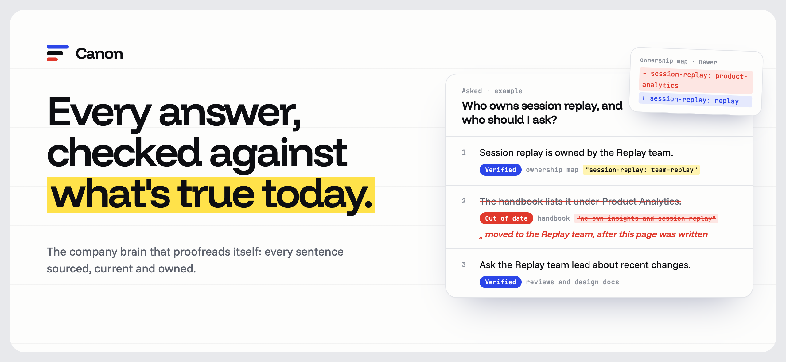
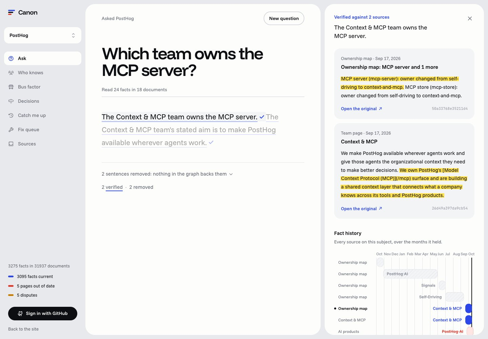
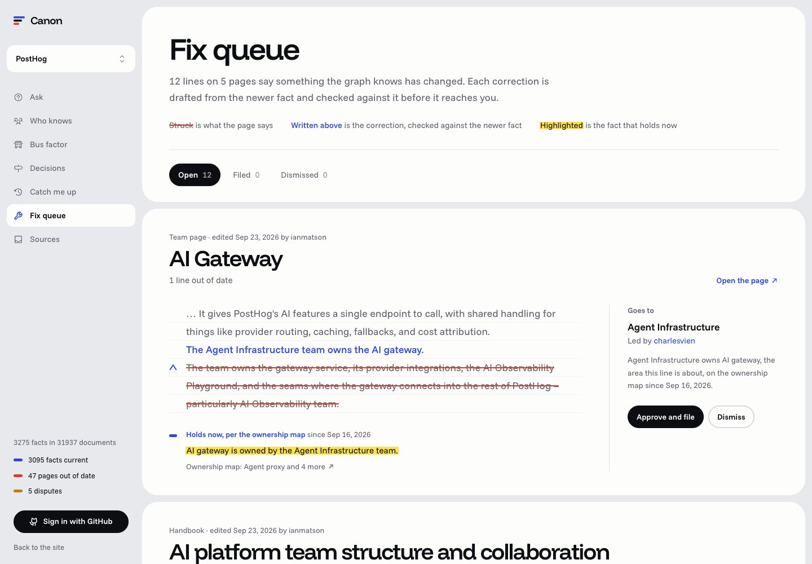
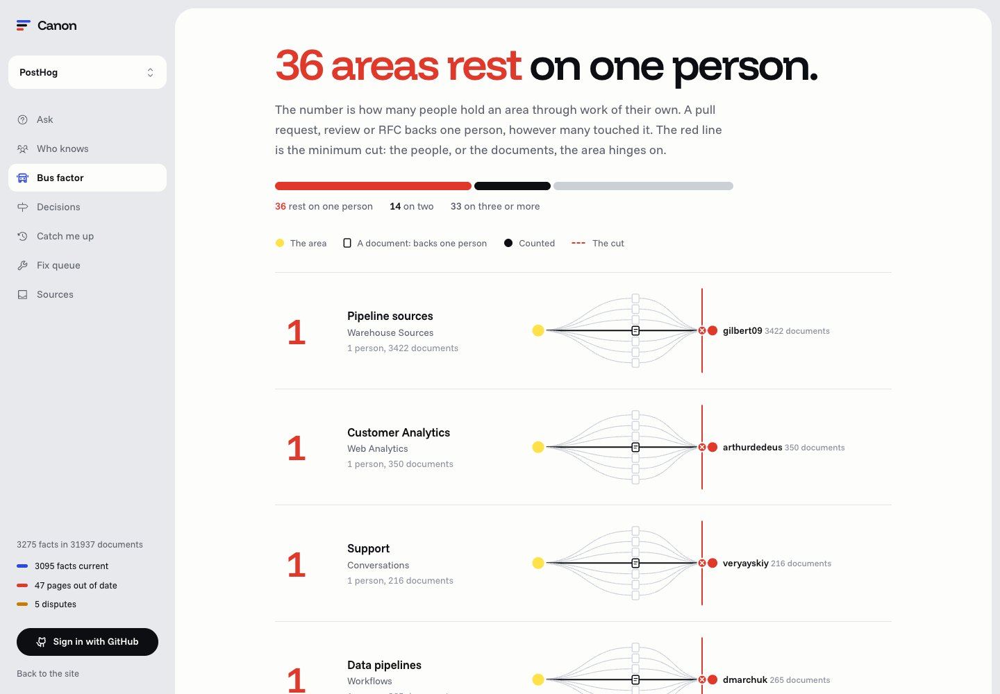

<p align="center">
  
</p>

<p align="center">
  <a href="https://canon.sushans.dev"></a>
  
  
  <a href="LICENSE"></a>
</p>

**Canon is a company brain that checks its own answers.** It reads a company's docs, tickets and chats into one FalkorDB graph that knows when each fact held. Ask it how the company works and every sentence of the answer comes back verified, out of date, disputed, or removed, each with its source. When it finds a page that says something no longer true, it drafts the fix and sends it to whoever owns that page.

**Try it:** [canon.sushans.dev](https://canon.sushans.dev) runs on PostHog's public handbook, design docs, issues, pull requests and forum. Ask "Which team owns the MCP server?", then open the Fix queue.

Every company-brain tool today can find text and cite it. None of them checks whether what it cites is still true. A handbook page that says the PostHog AI team owns the MCP server, written after ownership moved, gets quoted with a confident citation. Canon was built so that does not happen.

<p align="center">
  
</p>

## What a team uses it for

| | |
| --- | --- |
| **Ask** | Plain questions about the company, answered sentence by sentence. Each sentence carries its verdict and opens to the passage behind it and that fact's history. |
| **Fix queue** | Pages Canon found out of date: the stale line struck, the correction drafted from the newer fact and checked against it, routed to the team that owns the page. Approve, and Canon files it as a GitHub issue in a repository you choose. |
| **Who knows** | People ranked by what they did (wrote, reviewed, decided, said), not by title, with every piece of evidence one click away. |
| **Bus factor** | For each area, how many people hold its knowledge through work of their own, and the minimum cut it hinges on. A maximum flow, computed by FalkorDB. |
| **Decisions** | Every design doc from proposal to acceptance to replacement, with the pull requests that shipped it. |
| **Catch me up** | Drag back to when you left: every ownership change, decision, newly stale page and dispute since, with a checked summary. |
| **Sources** | What a workspace reads, and the tools it is connected to. |

<p align="center">
  
  
</p>

## How it works

1. **Read.** Connectors read docs, tickets and chats into one graph per workspace. Every passage keeps its document, author and date.
2. **Extract.** A model turns passages into facts in a closed vocabulary (`owned_by`, `leads`, `member_of`, `decided`, `process`, `policy`, `uses`, `contact_for`), each dated by its source. Structured sources state facts directly: the history of an ownership file gives every owner change with its commit date.
3. **Link.** Deterministic Cypher, no model, decides what replaced what. A newer fact on the same subject supersedes an older one; a page that restates an owner after a more authoritative source changed it is stale from the day it was written; two equally authoritative current sources that disagree are disputed. For free-text process and policy facts, a model only names pairs that cannot both hold, and the graph keeps that as an edge.
4. **Answer.** Retrieval finds facts by full-text search and by the people, teams, areas and topics a question names, then follows `SUPERSEDED_BY` to whatever holds now. A model drafts the answer one sentence at a time, each citing fact ids.
5. **Check.** Before a sentence is shown, the graph decides its verdict:

   | Verdict | Means |
   | --- | --- |
   | **Verified** | A source states it, and nothing newer replaced it. |
   | **Out of date** | A newer source replaced it. Canon shows the newer fact in its place, and when it changed. |
   | **Disputed** | Two current sources disagree. Canon shows both. |
   | **Removed** | Nothing in the graph backs it, so it is not shown. |

   A small model only confirms that each sentence says what its facts say. Whether a fact is current, replaced or disputed is never the model's call.

## What Canon reads

| Kind | Sources | How |
| --- | --- | --- |
| **Docs** | Markdown and MDX in a repository, GitHub wikis, Notion, Confluence, uploaded files (PDF, Word, HTML, Markdown, text) | Sign in with GitHub; Notion integration token; Confluence site and API token; upload |
| **Tickets** | GitHub issues and pull requests, Linear issues with their state history, Jira issues | Sign in with GitHub; Linear API key; Jira site and API token |
| **Chats** | Slack channels and threads, GitHub Discussions, issue and pull request comment threads, community forums | Slack bot token or a Slack export; sign in with GitHub |
| **Decisions** | ADR and RFC folders, design-doc repositories, releases | From the repository |
| **Ownership** | CODEOWNERS and ownership-map history, team rosters, project leads in Linear and Jira, owner fields in Notion databases | From each source |

Connected sources are read again every hour, so answers follow what changed. Private and organisation repositories work once you grant access. Credentials are encrypted at rest and never returned.

## Measured

56 questions about PostHog with known answers, taken from dated records, never written by a model: who owns an area now, who owned it before, who leads a team. 13 of them are **stale traps**, where a handbook page still names an owner the ownership map has since changed. Three systems answer every question with the same model (Claude Haiku 5.5), and Claude Sonnet 5.5 grades them:

- **Canon**.
- **Same evidence, no graph**: the model gets exactly the passages Canon retrieved, including the ones Canon only found by following the graph to the current fact, and answers with citations. The only thing it lacks is the graph's account of time and the check.
- **Search and summarise**: full-text search over every passage, the top eight to the model, answer with citations. The usual company-brain pipeline.

| | Canon | Same evidence, no graph | Search and summarise |
| --- | --- | --- | --- |
| Correct answers | **98%** | 95% | 20% |
| Out-of-date answers stated as current | **0%** | 2% | 5% |
| Stale traps answered correctly | **13 of 13** | 10 of 13 | 0 of 13 |
| Sentences whose citation states them | **86%** | 82% | 86% |

Where Canon falls short: on "who owned this before" questions it scored 83% against the baseline's 100%, because the check removed one true sentence about history as unsupported. Every question, every answer and every grade is in [`bench/results/haiku-sonnet-judge`](bench/results/haiku-sonnet-judge). Run it again with `uv run python -m canon.bench run --name <name>`.

## The graph

Each workspace is its own FalkorDB graph, so companies never share nodes. The demo graph holds 31,937 documents, 15,999 passages, 3,275 facts, 237 people, 77 teams and 130 areas.

```text
(:Document {id, kind, title, url, updated_at})-[:HAS]->(:Passage {id, text})
(:Document)-[:ABOUT]->(:Area)
(:Fact {id, subject, predicate, value, text, valid_from, valid_to, authority, stale})-[:STATED_IN]->(:Passage)
(:Fact)-[:ABOUT]->(:Area | :Team | :Person | :Topic)
(:Fact)-[:VALUE]->(:Team | :Person)
(:Fact)-[:SUPERSEDED_BY {reason}]->(:Fact)        // newer, or stale: wrong from the day it was written
(:Fact)-[:RESTATES]->(:Fact)
(:Fact)-[:CONTRADICTS {reason}]->(:Fact)

(:Person {handle, name})-[:AUTHORED | :REVIEWED | :COMMENTED | :DECIDED]->(:Document)
(:Person)-[:SAID]->(:Passage)                     // who said what in a chat or thread, and when
(:Person)-[:MEMBER_OF | :LEADS]->(:Team)
(:Person)-[:KNOWS {score, evidence}]->(:Area)
(:Area {bus_factor})-[:DEPENDS_ON]->(:Person)

(:Decision {id, title, status, decided_at})-[:PROPOSED_IN]->(:Document)
(:Decision)-[:SUPERSEDED_BY]->(:Decision)
(:Decision)-[:IMPLEMENTED_BY]->(:Document)
(:Decision)-[:ABOUT]->(:Area)

(:Fix {status, old, new})-[:ABOUT]->(:Fact)
(:Fix)-[:EVIDENCE]->(:Fact)
(:Fix)-[:ON]->(:Document)
(:Fix)-[:ROUTED_TO]->(:Team | :Person)
```

Is a claim still true? Follow its facts forward in time:

```cypher
MATCH (f:Fact) WHERE f.id IN $ids
MATCH (f)-[:SUPERSEDED_BY*1..6]->(n:Fact) WHERE NOT (n)-[:SUPERSEDED_BY]->()
RETURN f.id, n.id
```

Do two current sources disagree?

```cypher
MATCH (f:Fact) WHERE f.id IN $ids
MATCH (f)-[:CONTRADICTS]-(c:Fact) WHERE c.valid_to IS NULL AND NOT (c)-[:SUPERSEDED_BY]->()
RETURN DISTINCT f.id, c.id
```

Bus factor is a maximum flow from an area, through its evidence documents, to the people who know it. Three people who only reviewed the same pull request count once:

```cypher
MATCH (s) WHERE id(s) = $source
MATCH (t:Sink {id: $sink})
CALL algo.maxFlow({sourceNodes: [s], targetNodes: [t], capacityProperty: 'cap', relationshipTypes: ['FLOW']})
YIELD edges, edgeFlows, maxFlow
RETURN [e IN edges | id(e)], edgeFlows, maxFlow
```

The network, the minimum cut and a worked example are in [`docs/bus-factor.md`](docs/bus-factor.md).

## The demo company

The hackathon allows public data only, so the demo runs on a company that works in public: **PostHog**.

| Source | What it gives Canon | Licence |
| --- | --- | --- |
| [Handbook and team pages](https://github.com/PostHog/posthog.com/tree/master/contents) | What the company says, page by page, with edit history | MIT |
| [Feature ownership map](https://github.com/PostHog/posthog.com/blob/master/src/hooks/useFeatureOwnership.tsx) | Who owns which product area, and all 72 changes to it | MIT |
| [Design docs (RFCs)](https://github.com/PostHog/requests-for-comments-public) | 80 decisions, including proposals that were never merged | MIT |
| [Issues and pull requests](https://github.com/PostHog/posthog) | 28,099 merged pull requests over six months, 1,500 issues, who wrote and reviewed what | MIT |
| [Community forum](https://posthog.com/questions) | 1,474 threads of what people actually ask | Public pages |

Canon's own text names people by their public GitHub handles. Quoted passages appear exactly as PostHog published them, with a link to the original.

## Run it

```sh
docker compose up -d falkordb      # Canon's FalkorDB on :6380, its Browser on :3001
cd server && uv sync
uv run canon seed demo             # a small made-up company, no model calls
uv run canon serve                 # the API on :8790
cd ../web && npm install && npm run dev
```

Open `http://localhost:5173/app`. Answers need `ANTHROPIC_API_KEY`. Development runs every model call on Claude Haiku 5.5; `CANON_PROFILE=prod` uses Opus for answers and Sonnet for extraction. `uv run pytest -q` runs the tests (FalkorDB must be running).

To build the PostHog graph yourself: `GITHUB_TOKEN=... uv run canon ingest posthog`. Deployment is in [`docker-compose.prod.yml`](docker-compose.prod.yml), with a Traefik override.

## Repo layout

| Path | What it is |
| --- | --- |
| [`server/src/canon/sources`](server/src/canon/sources) | Connectors: GitHub, PostHog, Slack, Notion, Linear, Jira, Confluence, uploads |
| [`server/src/canon/extract`](server/src/canon/extract) | Passages to dated facts in a closed vocabulary |
| [`server/src/canon/verify`](server/src/canon/verify) | Supersession and disputes, and the check on every claim |
| [`server/src/canon/answer`](server/src/canon/answer) | Retrieval, drafting, and the answer stream |
| [`server/src/canon/people`](server/src/canon/people) | Expertise from evidence, and bus factor |
| [`server/src/canon/decisions`](server/src/canon/decisions) | Design docs and decision records |
| [`server/src/canon/fixes`](server/src/canon/fixes) | The fix queue and GitHub issues |
| [`server/src/canon/cloud`](server/src/canon/cloud) | GitHub sign-in, workspaces, members, jobs |
| [`server/src/canon/bench`](server/src/canon/bench) | The benchmark |
| [`web`](web) | The site and the app (Vite, React, Tailwind) |

## What we learned from

We studied these projects closely and wrote our own code.

| Project | What we took | What Canon adds |
| --- | --- | --- |
| [Graphiti](https://github.com/getzep/graphiti) | Facts with validity windows: a new fact closes an old one without deleting it | Checking each claim of an answer against those windows before it is shown |
| [Onyx](https://github.com/onyx-dot-app/onyx) | Connectors, and answers that respect who can see what | A graph of people, ownership and decisions, not only documents |
| [FalkorDB GraphRAG-SDK](https://github.com/FalkorDB/GraphRAG-SDK) | Provenance from document to chunk to entity | Provenance that also runs forward in time |
| [kotaemon](https://github.com/Cinnamon/kotaemon) | Showing the exact passage behind a sentence | A verdict on whether that passage is still true |
| [Microsoft GraphRAG](https://github.com/microsoft/graphrag), [LightRAG](https://github.com/HKUDS/LightRAG) | Graph and vector retrieval side by side | Incremental updates that change verdicts, not a rebuilt index |
| [Unblocked](https://getunblocked.com), [Guru](https://www.getguru.com) | Expertise from code review; knowledge that people verify on a schedule | Expertise from every source with its evidence, and verification on every answer |

## FalkorDB Hackathon

Built for the [FalkorDB Hackathon](https://www.wemakedevs.org/hackathons/falkordb) (October 15 to 18, 2026), entering **Track 03 · Company Brain**. Work on Canon began on October 15, during the event. FalkorDB is the only database: company knowledge, accounts, workspaces, connections, jobs and fixes all live in FalkorDB graphs. Raw downloads are cached as files only so a rebuild does not fetch them again.

We use AI coding assistants (Claude Code) for research, scaffolding and pair programming, and say so here as the rules require. We can explain every part of the graph model, the queries and the design.

## Creators

<table>
  <tr>
    <td align="center" width="160">
      <a href="https://github.com/sushanshetty1"><br><b>Sushan Shetty</b></a><br><sub>@sushanshetty1</sub>
    </td>
  </tr>
</table>

## License

[Apache-2.0](LICENSE).
